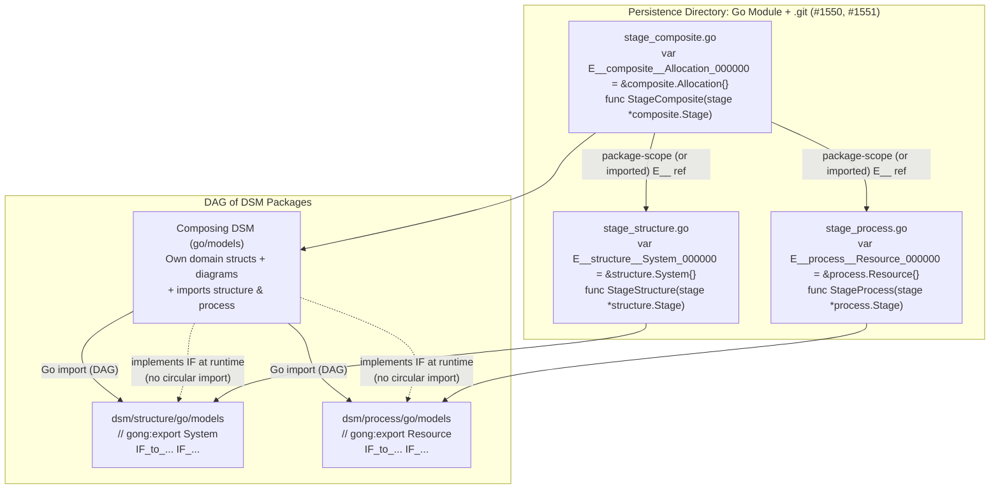

# Analysis of Issue #1542: Multi-DSM & DSM Composition in Gong

## 1. Guiding Principle: "Data is Code" (`godafor`)

Gong's persistence architecture is built on a single foundational rule: **persisted data is valid, idiomatic Go source code**.

1. **`gopls` & the Go Compiler as Consistency Engine**: Type safety, schema conformance, find-all-references, rename refactoring (`gopls rename`), and cross-file link integrity are enforced directly by standard Go tooling in VS Code rather than custom ad-hoc validators.
2. **Dataset Dependencies = Go Package Dependencies**: Just as Go programs decompose into packages wired via `import` and `go.mod`, Multi-DSM datasets decompose into per-stage `.go` files inside Go modules ([#1550](https://github.com/fullstack-lang/gong/issues/1550)) wired via exported Go variables (`var E__...`). A persistence module can also `import` another persistence module from an external repository (e.g. a shared reference library of standard `Data` or `System` definitions).
3. **Acyclic Dependencies (DAG Constraint on Both Metamodels and Data)**: Go's strict **no-circular-imports** rule transposes directly to modeling:
   - **Metamodel DAG**: Imported DSMs never import the composing DSM back. Upward/reverse visibility is achieved exclusively through runtime Go interfaces (`IF_...`), preserving a strict compile-time DAG.
   - **Dataset DAG**: Persistence modules that import upstream reference data modules must likewise form a strict DAG, enforcing clean layered modeling discipline (reference libraries → domain models → integration/simulation models).

---

## 2. Conceptual Architecture: Uniform DSM Composition (No Rigid "Weaving" Category)

[Issue #1542](https://github.com/fullstack-lang/gong/issues/1542) does **not** require inventing a separate, restricted "weaving-only" project type. Instead, Gong only needs a **general DSM composition mechanism**:

- **Every DSM is a first-class DSM**: Any DSM can define its own full domain concepts, diagrams, shapes, trees, and semantic rules, **and** optionally import one or more other DSM `go/models` packages to reference their `// gong:export` structs and/or implement their `IF_...` interfaces.
- **Pure Correspondence DSMs & Rich Composite DSMs**:
  - A *pivot/correspondence DSM* (e.g. `process_structure`, akin to ISO/IEC/IEEE 42010 correspondence views) is simply a DSM whose domain concepts represent typed links between `dsm/process` and `dsm/structure`.
  - Equally, a *domain DSM* (e.g. an operational scenario, deployment, or ATC simulation DSM) can have rich domain concepts and diagrams of its own **plus** weaving links into `dsm/structure` and `dsm/process`.
- **Autonomy of Imported Base DSMs**: Imported DSMs (`dsm/process`, `dsm/structure`) remain 100% standalone—they hold zero imports of any DSM that composes them, exposing only `// gong:export` structs and local `IF_...` interfaces probed at runtime (`!= nil`).



---

## 3. Gap Analysis: Current Gong Codebase vs. Target Architecture

| Area | Current Implementation | Target Requirement |
| :--- | :--- | :--- |
| **Persistence Format** | Single monolithic `.go` file (`func _(stage *models.Stage)`) in [gong_marshall_template.go](../go/golang/models/gong_marshall_template.go#L363). | Self-contained Go module directory (`go.mod` + `stage_<dsm>.go` per stage) inspectable as a workspace in VS Code (#1550). |
| **History & Diffing** | In-file `GongMarshallingAppendCommit` appending diffs inside `func _(...)` ([gong_slices.go](../go/golang/models/gong_slices.go#L130)). | `.git` subdirectory managed via pure-Go `go-git` (in both Native CLI and WASM) committing clean `stage_<dsm>.go` snapshots for native VS Code Git history/diffing (#1551). |
| **WASM Load & Save (`lib/load`)** | [load-specific.component.ts](../lib/load/ng-github.com-fullstack-lang-gong-lib-load/projects/loadspecific/src/lib/load-specific/load-specific.component.ts) handles a single `.go` file. | Directory browse (`showDirectoryPicker`) & folder drop (`getAsFileSystemHandle`) syncing `go.mod`, `stage_*.go`, and `.git/` in-place on disk. |
| **Interface Fields in Metamodel** | Ignored by [generate_field_parser.go](../go/models/generate_field_parser.go) (except `any` with `//gong:meta`). | First-class `GongInterfaceField` (scalar & slice) persisted in **Stage form only** (excluded from `_WOP` / SQLite). |
| **Sibling / External DSM Imports** | [dependency_discovery.go](../go/models/dependency_discovery.go#L110-L114) restricts sub-stages to subdirectories under `go/models`. | Resolve imported Gong `models` packages across sibling directories (`dsm/process/go/models`) and external Go modules (`go.mod`). |
| **Cross-Stage Hooks & Lifecycle** | Local variables (`__Struct__00000000_ := ...`); single-file `Squash()`. | `// gong:export` emits `var E__... = &pkg.Struct{}` + `func Stage<Model>(stage *<pkg>.Stage)`; `nil` tombstones for isolated edits + full deletion & `Squash` at the directory/module level. |
| **Frontend View Composition** | DSM `Stager`s ([stager.go](../dsm/project/go/models/stager.go#L76-L88)) hardcode `""` and `"shapeFormStage"` for sub-stacks. | Namespace UI sub-stacks per `stage.GetName()` so a composing DSM reuses imported DSM views (`Tree`/`SVG`/`Form`) alongside its own views via `lib/split`. |

---

## 4. Directory Persistence, `.git` History, & WASM Architecture (#1550 & #1551 First)

> [!TIP]
> **Standalone Prerequisite**: Directory persistence (`go.mod` + `stage_<dsm>.go`), `.git` auto-commits, and WASM directory selection do **not** depend on Multi-DSM. Implementing them **first** on existing single DSMs makes it possible to validate the entire VS Code + Git + WASM workflow immediately.

### 4.1 Canonical Generated File Signature (`Stage<Model>`)
Each stage persists to its own file `stage_<model>.go` inside `package data` (or `package persistance`) using the canonical `Stage<Model>(stage *<pkg>.Stage)` signature (aligned with [gong-go-api.md](./gong-go-api.md)):

```go
package data

import (
	structure "github.com/fullstack-lang/gong/dsm/structure/go/models"
)

var E__structure__System_000000 = &structure.System{}

func StageStructure(stage *structure.Stage) {
	// Exported instance: pre-allocated at package init, staged in-place
	__structure__System_000000_ := E__structure__System_000000.Stage(stage)

	// Non-exported instances (diagrams, concrete shapes): remain function-local
	__structure__DiagramStructure_000000_ := (&structure.DiagramStructure{Name: `Main`}).Stage(stage)

	// Field-by-field initialization preserves runtime IF_... regardless of Stage*() call order
	__structure__System_000000_.Name = `System1`
	__structure__DiagramStructure_000000_.Name = `Main`
}
```

### 4.2 `.git` Subdirectory & VS Code Inspection (`go-git` in Native & WASM)
Instead of relying on in-file `GongMarshallingAppendCommit` diffs, the persistence directory is a **real Git repository** (`.git/` + `go.mod` + `stage_*.go`) using `GongMarshallingNormal` full-file snapshots:

1. **Direct Exploration in VS Code**: Opening the persistence directory in VS Code (completely independently of any running DSM) provides:
   - Full **`gopls`** intelligence across all `stage_*.go` files (type-checking, hover, find-all-references on `E__...` across DSMs, `gopls` rename).
   - Native **VS Code Source Control, Timeline, and side-by-side diffs** on readable `.go` stage files for every model edit/save.
2. **Pure-Go `go-git` Across Both Native CLI & WASM**:
   - `github.com/go-git/go-git/v5` is 100% pure Go with an in-memory virtual filesystem (`go-billy` `memfs`), so it compiles cleanly to both native binaries and `GOOS=js GOARCH=wasm` (WASM bundle size is acceptable).
   - **Fast In-Memory WASM + Disk Sync Architecture**:
     - **On Load** (`window.showDirectoryPicker({ mode: 'readwrite' })` or directory drag-and-drop via `dataTransfer.items[0].getAsFileSystemHandle()` in [load-specific.component.ts](../lib/load/ng-github.com-fullstack-lang-gong-lib-load/projects/loadspecific/src/lib/load-specific/load-specific.component.ts)): Angular recursively reads the chosen folder (including `.git/**`, `go.mod`, `stage_*.go`) and transfers the snapshot to Go WASM `memfs`. Go opens `.git` (or runs `git.Init` if absent) and parses `stage_*.go`.
     - **On Commit / Save**: Go WASM rewrites the modified `stage_<dsm>.go` in `memfs`, runs `worktree.Add` + `worktree.Commit` **in RAM** (<5 ms), and sends only the dirty/created files in `memfs` back to Angular's cached `FileSystemDirectoryHandle` (stored in IndexedDB) to overwrite/sync the directory in-place on disk—immediately visible in VS Code's Git graph!
     - *(Note: When pointing CLI at an existing `gong/dsm/.../data` folder already inside a parent Git repo, `.git` initialization remains opt-in via flag so it doesn't accidentally nest a Git repo inside `gong` itself.)*

---

## 5. Metamodel, Deletion / `Squash` Lifecycle, & Runtime Modes

### 5.1 First-Class Interface Fields (`GongInterfaceField` — Stage-Only)
Adding `GongInterfaceField` (scalar `MyIF` and slice `[]MyIF`) to Gong's metamodel is an independent step with immediate value across the repository:
- **Stage-Only (No `_WOP` / SQLite)**: `_WOP` ([gong_wop.go](../go/golang/models/gong_wop.go)) only copies scalar fields for GORM/SQLite. Interface fields are polymorphic pointer references persisted exclusively in `Stage` Go files, AST unmarshalling, `Clean`, and `Probe` forms.
- **`reflect`-Free Codegen**: Using `modelPkg.Implements` ([model_pkg.go](../go/models/model_pkg.go#L223-L268)), `gong generate` emits static type switches over all implementing `GongStruct`s.
  - **Intra-DSM interfaces** (≥1 local/imported `GongStruct` implements `MyIF`, e.g. polymorphic `DataFlow` endpoints in `dsm/process`): marshalled/unmarshalled directly in `stage_<pkg>.go` and selectable in Probe dropdowns.
  - **Reverse Multi-DSM interfaces** (0 structs in the base DSM implement `IF_to_...`): left untouched by the base marshaller, displayed read-only in the base Probe when non-nil, and wired statically by the composing DSM's generated `stage_<composite>.go` (`E__base__X.IF_to_... = __composite__Y_`) and live `BeforeCommit`/`Clean` hooks!

### 5.2 Two-Level Deletion & Keeping `Squash` at the Directory/Module Level
- **Isolated Single-Stage Edits (`nil` Tombstones)**: If a user runs a base DSM standalone (`structure edit my_dir/`) and deletes an exported `System`, `stage_structure.go` keeps `var E__structure__System_000000 *structure.System = nil` (with `// Deprecated: unstaged` so `gopls` flags references in VS Code) while `stage_composite.go` guards reverse interface wiring with `if E__structure__System_000000 != nil`. Thus `my_dir/` **still compiles** before the composing DSM is next opened.
- **Directory / Module-Level `Squash` & Complete Deletion**: When operating at the **whole directory / module level** (in the composing Multi-DSM or a module-level `squash`/`clean` command where all `stage_*.go` files in the module are loaded and cross-stage consistency is checked):
  - Dangling pointers in composing stages are cleaned.
  - Unreferenced `nil` tombstones and deleted instances are **completely removed**.
  - `Squash` can safely compact history and, when desired (for unexported or module-internal symbols), re-index across all `stage_*.go` files in the module atomically while verifying consistency.

### 5.3 Dual Runtime Modes: Composing DSM vs. Standalone Base DSM
A persistence directory containing `stage_structure.go`, `stage_process.go`, and `stage_composite.go` can be edited in **both** modes:
1. **Composing / Multi-DSM Mode (`composite edit my_dir/`)**: Loads all stages into memory, populates all `IF_to_...` reverse interfaces, enforces cross-DSM semantic rules, renders interface endpoints on base diagrams, and saves any modified `stage_*.go` files.
2. **Standalone Base DSM Mode (`structure edit my_dir/`)**: Reads and writes **only** `stage_structure.go` (with `structure`'s intra-DSM consistency rules enabled), leaving `stage_process.go` and `stage_composite.go` untouched.
   > **Important Standalone Diagram Behavior**: In standalone mode, because the composing DSM is not loaded in memory, **all reverse-interface (`IF_to_...`) endpoints in the base DSM's diagrams and probes will evaluate to `nil` (empty)**—and will automatically reappear when the directory is reopened in the composing DSM.

### 5.4 Sibling & Cross-Module DSM Dependency Resolution
Because any DSM can both own domain structs and import sibling/external DSMs, [dependency_discovery.go](../go/models/dependency_discovery.go#L110-L114), [type_analysis.go](../go/models/type_analysis.go#L78-L82), [gong_stageset.go](../go/golang/models/gong_stageset.go#L312-L320), and [stageset_probe.go](../go/golang/probe/stageset_probe.go#L60-L69) must resolve imported Gong `models` packages anywhere in the current `go.mod` (e.g. `dsm/process/go/models`) or in external `go.mod` dependencies, verifying that the DSM dependency graph is a DAG.

---

## 6. Frontend View Composition (`lib/split` & `Stager` Reuse)

A composing DSM that imports `dsm/process` and `dsm/structure` reuses their full views (`Tree`, `SVG`, `ShapeForm`, `Probe`) alongside its own views:

1. **Nested & Tabbed Views via `lib/split`**: [lib/split/go/models/models.go](../lib/split/go/models/models.go#L26-L101) already allows `AsSplitArea` to embed sub-`Split`s or individual `Tree`/`Svg`/`Form` stacks by `StackName`. The composing DSM's root `splitStage` can offer both dedicated perspective tabs (`"Process"`, `"Structure"`, `"Composite / Weaving"`) and side-by-side workbench views (`[ Structure | Composite | Process ]`), sharing a single unified directory `Load`/`Button` bar.
2. **Sub-Stack Namespacing in `dsm/project` (`stager.go` & `yyy_*`)**: Today, `NewStager` ([stager.go](../dsm/project/go/models/stager.go#L76-L88)) hardcodes `""` and `"shapeFormStage"` for UI sub-stacks, which collides when multiple `Stager`s share one `http.ServeMux`. Prefixing sub-stack names with `stage.GetName()` (e.g. `"process-tree"`, `"structure-svg"`) and exposing `stager.BuildMainEditSplitArea()` makes every DSM's UX cleanly embeddable inside any composing DSM.
3. **Cross-Stager Live Refresh**: When the composing stage commits, its `AfterCommit` hook updates runtime `IF_to_...` fields and refreshes the embedded `processStager` and `structureStager` SVG/Tree views directly without triggering cascading `Commit()` calls.

---

## 7. Proposed Sub-Issues Breakdown for Issue #1542

Ordered so the **Directory + `.git` + WASM persistence foundation** can be used and validated on existing single DSMs first, followed by **Interface fields**, **DSM DAG composition**, and **UI composition**:

| Order | Sub-Issue Title | Existing / New | Scope & Deliverables |
| :---: | :--- | :---: | :--- |
| **1** | **dsm / gong: persist stage data as a Go module directory (`Stage<Model>`)** | [#1550](https://github.com/fullstack-lang/gong/issues/1550) | Add directory persistence option (`edit <dir>`, `read <dir>`) to `gong` (`zzz_gong_marshall.go`, `zzz_gong_ast2.go`, `level1stack`) and DSM CLIs, generating a valid Go module (`go.mod` + `stage_<model>.go` with `func Stage<Model>(stage *<pkg>.Stage)`), usable immediately on any single DSM. |
| **2** | **dsm / gong: manage a `.git` repository in persistence directories via `go-git`** | [#1551](https://github.com/fullstack-lang/gong/issues/1551) | Integrate pure-Go `go-git` (`memfs` + disk sync) so reading a persistence directory opens/initializes `.git` and saving commits clean `GongMarshallingNormal` snapshots—enabling direct Git history, timeline, and diff exploration in VS Code. |
| **3** | **lib/load: WASM directory browse (`showDirectoryPicker`), folder drop, and in-place sync** | *New* | Extend `lib/load` Angular & Go bridges to select or drop a directory via `FileSystemDirectoryHandle` (cached in IndexedDB) and synchronize `go.mod`, `stage_*.go`, and `.git/` in-place from WASM portable apps. |
| **4** | **gong: support `GongInterfaceField` (scalar & slice) in Stage persistence and Probe** | *New* | Add `GongInterfaceField` to the Gong metamodel (Stage-only, excluded from `_WOP`/SQLite) with `reflect`-free marshalling, AST unmarshalling, `Clean`, and `Probe` selectors via `modelPkg.Implements`; validate on single-DSM polymorphic associations. |
| **5** | **gong: support DAG composition of sibling and external-module DSM `models` packages** | *New* | Generalize `dependency_discovery.go`, `type_analysis.go`, `gong_stageset.go`, and `stageset_probe.go` so any DSM `go/models` can define its own structs while importing sibling (`dsm/*/go/models`) or external Go module DSMs (enforcing DAG acyclicity). |
| **6** | **gong: `// gong:export`, `E__` hooks, reverse `IF` wiring, and module-level `Squash`/GC** | *New* | Implement `// gong:export` (`var E__... = &pkg.Struct{}`), static reverse-interface wiring in composing stages, `nil` tombstones (`// Deprecated: unstaged`) for standalone single-stage deletes, and whole-directory/module `Squash` & complete dead-instance removal where cross-stage consistency is checked (plus cross-module data imports). |
| **7** | **dsm: namespace `Stager` UI sub-stacks and compose DSM views via `lib/split`** | *New* | Namespace `treeStage`, `svgStage`, `shapeFormStage`, etc. with `stage.GetName()` in `dsm/project` (propagated to all DSMs) and expose `BuildMainEditSplitArea()` so a composing DSM embeds imported DSM views alongside its own views. |
| **8** | **dsm: pilot composed DSM linking `dsm/process` and `dsm/structure`** | *New* | Mark pivot concepts (`System`, `Part`, `Resource`, `Participant`, `Data`) with `// gong:export` and `IF_to_...` in `process` & `structure` (verifying empty interface endpoints in standalone mode) and build the first composed DSM with unified multi-view UI and VS Code-inspectable directory persistence. |
